<p align="center">
  
</p>

<h1 align="center">Khatt · خط</h1>

<p align="center">
  <b>Type a word. Watch it written in Arabic calligraphy.</b><br />
  Twelve animated effects, six classic styles, four compositions.<br />
  Free, open source, and it runs in your browser, your terminal and Claude.
</p>

<p align="center">
  <a href="https://m-alkassem.github.io/khatt/"><b>Open the studio</b></a> ·
  <a href="#use-it-with-claude">Use it with Claude</a> ·
  <a href="#command-line">Command line</a> ·
  <a href="#how-it-works">How it works</a>
</p>

<table>
  <tr>
    <td align="center"><br /><b>Pen</b> · قلم</td>
    <td align="center"><br /><b>Gold leaf</b> · ذهب</td>
    <td align="center"><br /><b>Ink bleed</b> · حبر</td>
  </tr>
  <tr>
    <td align="center"><br /><b>Zellige</b> · فسيفساء</td>
    <td align="center"><br /><b>Sand</b> · رمل</td>
    <td align="center"><br /><b>Neon</b> · نيون</td>
  </tr>
  <tr>
    <td align="center"><br /><b>Stars</b> · نجوم</td>
    <td align="center"><br /><b>Lantern</b> · فانوس</td>
    <td align="center"><br /><b>Rise</b> · نهوض</td>
  </tr>
  <tr>
    <td align="center"><br /><b>Seal</b> · ختم</td>
    <td align="center"><br /><b>Reveal</b> · كشف</td>
    <td align="center"><br /><b>Wave</b> · موج</td>
  </tr>
</table>

Every image above is a single, self-playing SVG file made by Khatt: no video, no
JavaScript. Drop one into a website, a slide or a README and it just plays.

## Styles and compositions

Six open calligraphy fonts, each shaped properly: letters joined, right to left,
dots and marks where they belong.

<table>
  <tr>
    <td align="center"><br />Ruqʿah · رقعة</td>
    <td align="center"><br />Naskh · نسخ</td>
    <td align="center"><br />Kufic · كوفي</td>
  </tr>
  <tr>
    <td align="center"><br />Nastaʿlīq · نستعليق</td>
    <td align="center"><br />Kano · كانو</td>
    <td align="center"><br />Geometric · هندسي</td>
  </tr>
</table>

Lay the words out on a line, bend them into an **arc**, wrap them into a **ring**
around an eight-pointed star, or mirror them into a classic **musanna** (مثنّى).

<table>
  <tr>
    <td align="center"><br />Arc · قوس</td>
    <td align="center"><br />Ring · دائرة</td>
    <td align="center"><br />Mirror · مثنّى</td>
  </tr>
</table>

## The studio

**[m-alkassem.github.io/khatt](https://m-alkassem.github.io/khatt/)**: type your words, pick a style, a
layout, colours and an effect, and download:

- **SVG**: the animation itself, tiny and sharp at any size.
- **PNG**: the finished drawing, for print, stickers and logos (transparent background available).
- **MP4**: a square 1080 video for Instagram, LinkedIn, TikTok and WhatsApp status.

Every setting lives in the link, so you can share exactly what you made. Everything happens in your
browser; nothing is uploaded.

## Use it with Claude

Khatt ships as a Claude skill. Install it in Claude Code:

```
/plugin marketplace add M-Alkassem/khatt
/plugin install khatt@khatt
```

or with the skills CLI, for Claude Code and other agents:

```
npx skills add M-Alkassem/khatt
```

Then just ask:

> Write my daughter's name, Sara, in Arabic calligraphy with gold leaf.
>
> Make an animated "Ramadan Kareem" for my website header.
>
> I need a Kufic logo for my café, Qahwa, on a transparent background.

Claude transliterates names into Arabic script, picks a style and effect that suit the occasion,
and writes the file. It runs entirely offline: the skill carries its own fonts and shaping engine.

### Make your own effect with Claude

Ask for something that isn't in the twelve, like *"make the letters burn away into embers"*, and
Claude writes a brand-new effect: one small `.mjs` file following Khatt's effect contract, then
renders your words with it. [`skills/khatt/examples/ripple.mjs`](skills/khatt/examples/ripple.mjs)
shows what an effect looks like. If yours turns out beautiful, send it in as a pull request.

## Command line

```bash
node skills/khatt/scripts/khatt.mjs "سلام عليكم" --style kufi --layout arc --effect lantern -o salam.html
```

| Option | Values |
|---|---|
| `--style` | `ruqaa`, `naskh`, `kufi`, `nastaliq`, `kano`, `blaka` |
| `--layout` | `line`, `arc`, `circle`, `mirror` |
| `--effect` | `ink`, `gold`, `bleed`, `mosaic`, `sand`, `neon`, `stars`, `lantern`, `rise`, `stamp`, `reveal`, `wave`, or a path to your own `.mjs` |
| `--palette` | `paper`, `night`, `neon`, `zellige`, `desert`, `clear` |
| `--ink`, `--accent`, `--bg` | your own colours (`--bg none` for transparent) |
| `--still` | freeze on the finished drawing |
| `-o` | `.svg`, or `.html` for a page that replays on click |

The script is a single file with no dependencies. It needs Node 20 or newer.

## How it works

1. **Shaping.** Arabic letters change shape with their neighbours, and marks stack above and below
   them. Khatt runs [HarfBuzz](https://harfbuzz.github.io/) (compiled to WebAssembly) on the text, the
   same engine browsers and operating systems use, so every word is joined and ordered correctly.
2. **Outlines.** Each glyph becomes a vector path. The arc and ring layouts warp those paths point by
   point (not letter by letter), so joins stay connected even when the words bend.
3. **Effects.** An effect turns the letters into SVG elements with CSS animations, staggered in
   reading order from right to left. Particles for sand and stars are sampled inside the letters with
   a winding-number test.
4. **Any frame, no script.** Every animation's delay is written as
   `calc(var(--d) - var(--seek))`. Set `--seek` and pause, and the SVG shows exactly that moment. The
   PNG and MP4 exports use this to grab frames, and the MP4 is encoded in the browser with WebCodecs.

The output is deterministic: the same words and settings always give the same file.

## Fonts

| Style | Font | Licence |
|---|---|---|
| Ruqʿah | [Aref Ruqaa](https://github.com/aliftype/aref-ruqaa) | SIL OFL 1.1 |
| Naskh | [Amiri](https://github.com/aliftype/amiri) | SIL OFL 1.1 |
| Kufic | [Reem Kufi](https://github.com/aliftype/reem-kufi) | SIL OFL 1.1 |
| Nastaʿlīq | [Noto Nastaliq Urdu](https://github.com/notofonts/nastaliq) | SIL OFL 1.1 |
| Kano | [Alkalami](https://software.sil.org/alkalami/) | SIL OFL 1.1 |
| Geometric | [Blaka](https://github.com/Gue3bara/Blaka) | SIL OFL 1.1 |

Thank you to the type designers who made these freely available.

## Development

```bash
npm install
npm run dev          # the studio at http://localhost:5173
npm test             # unit tests
npm run khatt -- "خط" -o test.svg
npm run build:skill  # rebuild the bundled skill after changing src/
npm run gallery      # re-render the images in this README
```

Effects live in [`src/effects/`](src/effects/). Each is one small file; copy one to start a new effect.

## Licence

Code: [MIT](LICENSE). Fonts: SIL Open Font License 1.1, see `fonts/OFL-*.txt`.
